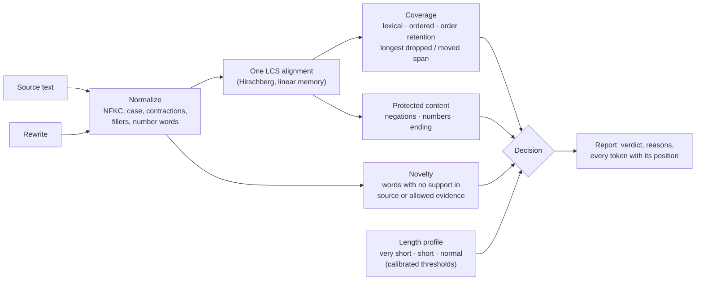
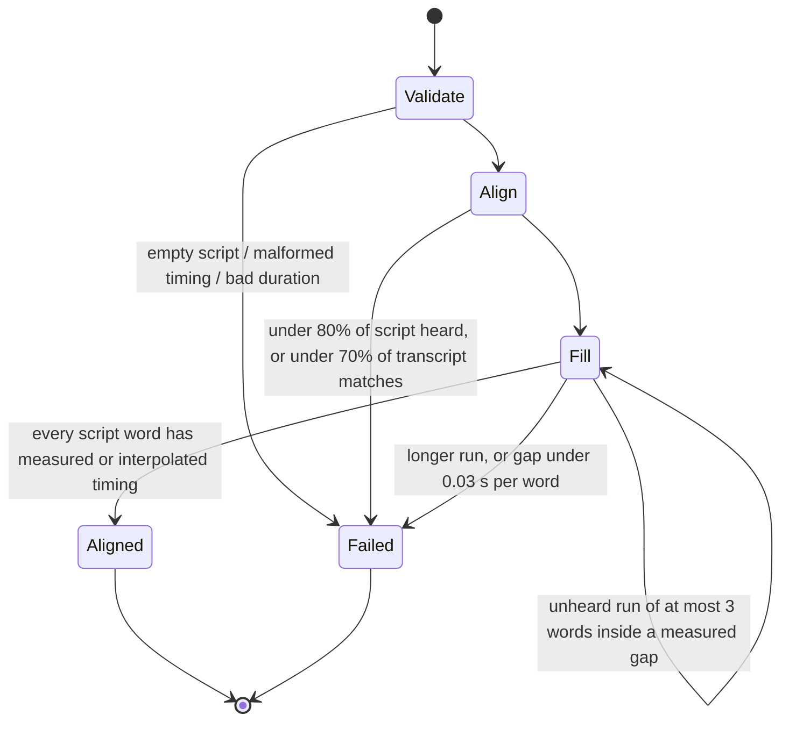
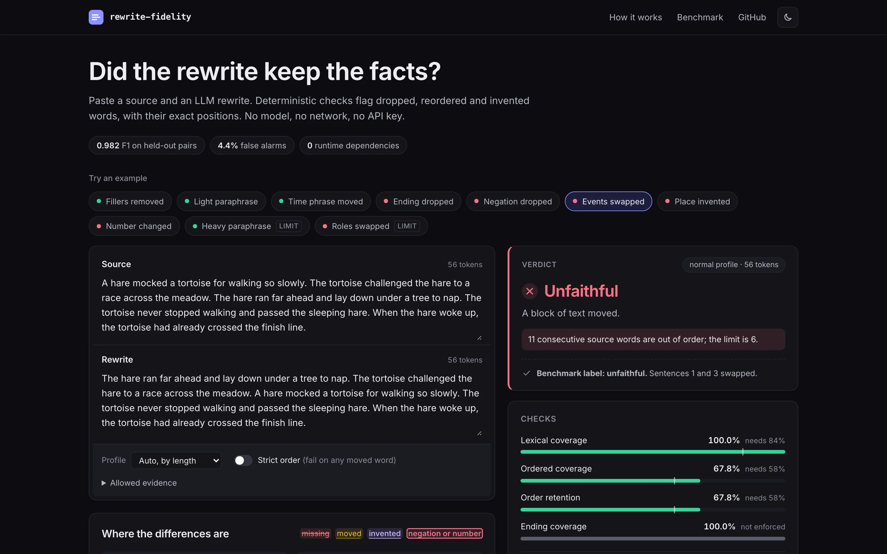
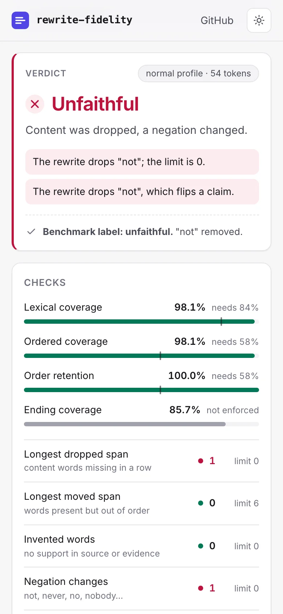
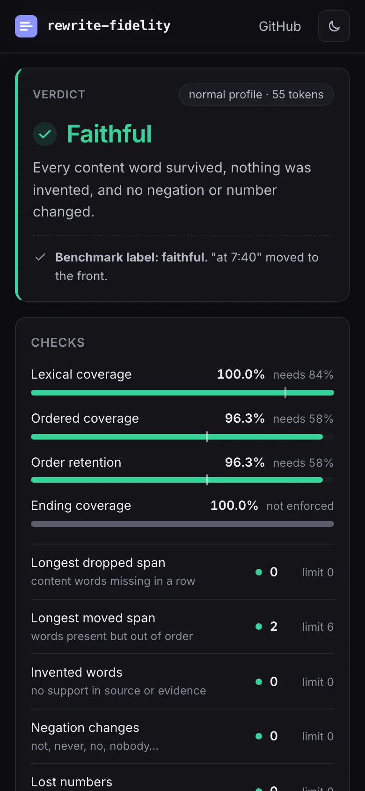

# rewrite-guard

**A deterministic guardrail for LLM rewrites: it fails the output that dropped a "not", changed 40 to 45 or invented a city, and points at the exact word.**


[](https://github.com/Nadimul96/rewrite-guard/actions/workflows/ci.yml)
[](LICENSE)


| At a glance | |
| --- | --- |
| Held-out F1 on 1,816 adversarial pairs | **0.982** (hand-set thresholds: 0.935) |
| False-alarm rate | **4.4%** (hand-set: 12.2%) |
| Throughput | about 31,000 checks/s on an M1 |
| Model calls, API keys, network | none |

## Where AI fits

rewrite-guard does not call a model. It sits *after* one, as a guardrail and an eval layer:

- **Runtime guardrail.** Run `checkFidelity(source, llmOutput)` on every rewrite before it ships. A failure returns typed reasons (`novel_tokens`, `negation`, `number`, `dropped_span`, `moved_span`) with character positions, so you can retry the model, show the diff to a reviewer, or fall back to the source. Facts the model may legitimately add go in `allowedEvidence` ([`src/check.ts`](src/check.ts)).
- **Offline eval.** The adversarial benchmark ([`bench/`](bench)) is a labeled test set of 13 unfaithful and 5 faithful edit types; the same report doubles as a per-failure-type scorecard for comparing prompts or models on your own source/output pairs.
- **ASR post-processing.** [`alignTranscript`](src/transcript.ts) forces speech-recognition word timestamps onto a known script (for captions or karaoke-style highlighting), and refuses with a typed reason rather than inventing timing.
- **Not included:** no LLM judge, no embeddings, no semantic paraphrase detection. Synonyms count as invented words; pair it with a semantic method when rewrites are meant to paraphrase.

## The problem

You ask a model to clean up a transcript, tighten an incident note or reformat a notice, and it hands back fluent text that quietly says something else: a "not" is gone, 40 minutes became 45, the ending was dropped, two events swapped places, a city appeared that nobody mentioned. The usual defenses are embedding similarity or a second model acting as judge. Both are slow and costly at volume, neither gives the same answer twice for certain, and neither can point at the word that changed. A paraphrase and a fabrication can score the same cosine similarity.

This library takes the opposite trade. It compares the two texts word by word, after normalizing what does not matter (case, punctuation, contractions, fillers, number words), and fails the rewrite with a reason and a character position for every missing, moved or invented word. It is strict by design: it accepts surface edits and rejects new vocabulary, which is the right contract for cleanup, formatting and tightening, and the wrong one for free paraphrase.

## Why this is novel

- **One alignment, three independent checks.** A single longest-common-subsequence pass ([`src/lcs.ts`](src/lcs.ts)) feeds coverage, novelty and protected-content checks ([`src/check.ts`](src/check.ts), [`src/decide.ts`](src/decide.ts)). The LCS is Hirschberg's linear-memory variant with 32-bit rows and shared prefix and suffix trimming, replacing two duplicated 16-bit copies that silently wrapped past 65,535 matched tokens.
- **Thresholds calibrated on held-out data, not set by hand.** An adversarial benchmark ([`bench/`](bench)) generates 3,626 labeled pairs from 13 kinds of unfaithful edit and 5 kinds of faithful one, calibrates on half the documents and reports on the other half. The calibrated profile lifts held-out F1 from 0.935 to 0.982 and cuts false alarms from 12.2% to 4.4%. CI fails if the committed numbers drift from the code.
- **Spans, not just ratios.** A ratio dilutes with length: losing one sentence of thirty barely moves coverage. The decisive checks are content-word spans ([`src/runs.ts`](src/runs.ts)): no content word may be dropped, and in a normal-length text no block of more than six words may move. Function words inside a block are bridged, so the alignment borrowing a "the" cannot split a moved sentence in two.
- **A second capability: forced alignment.** [`alignTranscript`](src/transcript.ts) puts ASR word timestamps onto the exact words of a script, keeps the script's punctuation and casing, interpolates at most a short unheard run inside a real measured gap, and otherwise fails with a typed reason instead of guessing.
- **A playground that explains itself** ([`playground/`](playground)): paste two texts and see every gauge against its threshold and every changed word highlighted in place, with one-click examples taken straight from the benchmark generators.

## Quickstart

Requires Node 22 (see `.nvmrc`) and pnpm. No API keys, no network at run time.

```bash
git clone https://github.com/Nadimul96/rewrite-guard.git
cd rewrite-guard
pnpm install
pnpm demo        # the CLI on bundled examples: one pass, one fail, one forced alignment
pnpm dev         # the playground at http://localhost:5173
```

The CLI:

```bash
pnpm build
node dist/cli/main.js check examples/incident.source.txt examples/incident.unfaithful.txt
node dist/cli/main.js check source.txt rewrite.txt --json      # machine-readable, with line:column positions
node dist/cli/main.js align script.txt asr-words.json --duration 12.4
```

Exit codes: `0` faithful (or aligned), `1` unfaithful (or the alignment failed honestly), `2` usage or input error.

The library (not yet published to npm; build it and import from `dist/`):

```ts
import { checkFidelity } from "rewrite-guard";

const report = checkFidelity(
	"The courier did not sign for the 3 parcels at the Leeds depot on Monday.",
	"The courier signed for the 4 parcels at the Leeds depot on Monday.",
);

report.passes; // false
report.failures.map((failure) => failure.message);
// 73.3% of source words appear at all; the normal profile needs 84%.
// The rewrite drops a 6-word stretch ("did … 3"); the limit is 0.
// The rewrite adds unsupported words: "signed", "4".
// The rewrite drops "not", which flips a claim.
// The rewrite loses the number "3".
report.novel.map(({ text, start, end }) => [text, start, end]); // [["signed", 12, 18], ["4", 27, 28]]
```

## How it works



1. **Normalize.** Both texts become token sequences that keep the character span of every surface word. "Didn't" becomes `did not` (both pointing at the same span), "three" becomes `3`, "3,000" becomes `3000`, "um" is dropped, and "you know" is dropped only when punctuation brackets it, so "you know him" stays. The tables live in a pluggable [`Locale`](src/locale.ts); English ships.
2. **Align once.** The LCS pairs source and rewrite tokens that survive in order. Unaligned tokens that still match each other are *moved*; source tokens left over are *missing*; rewrite tokens left over are *extra*, and extra tokens that are neither function words nor supported by the source or the supplied evidence are *novel*.
3. **Decide.** The profile is chosen by source length. Ratios and span lengths are compared with its thresholds; an invented word, a flipped negation or a lost number fails under any profile.

The same LCS anchors rewrite segments (captions, bullets, paragraphs) back to the source span each one covers ([`anchorSegments`](src/anchor.ts)), replacing a greedy matcher whose first forward hit on a common word skipped past text a later segment needed.

`alignTranscript` follows its own small state machine:



## Benchmark

`pnpm bench` builds the dataset from four sources: 30 four-beat stories (adapted from a golden test set in the private product this was extracted from, rewritten as neutral generic anecdotes), 16 Aesop fables retold in original wording, 16 synthetic operational notices dense with names, places and numbers, and 36 very short phrases. Each document, each sentence and each phrase is a unit; every applicable perturbation of every unit is a labeled pair.

- **Unfaithful (should flag):** drop the ending, a middle sentence, scattered details, a trailing time or place phrase, or a negation; swap two events or reorder all of them; insert a new name, place or number; replace a number or a name; swap who did what.
- **Faithful (should pass):** punctuation and casing changes, filler removal, light paraphrase (contractions, number format, article swaps, merged sentences), moving a time or place phrase to the front, and hand-written paraphrases.

Documents are split in half, stratified by kind, with every sentence staying on its document's side. Thresholds are chosen on the calibration half to maximize type-balanced F1 (each perturbation type weighs the same, so nearly 200 inserted names cannot drown out a dozen role swaps), subject to every surface-only edit staying under a 10% false-alarm rate. The numbers below are from the other half. They are deterministic; `pnpm bench:check` recomputes them in CI.

<!-- benchmark:start -->
Held-out half: **1,816 labeled pairs** (3,626 in total: 2,393 unfaithful, 1,233 faithful) generated from 30 stories, 16 fables, 16 notices and 36 short phrases. "Positive" means unfaithful.

| Thresholds | Precision | Recall | F1 | False-alarm rate |
| --- | ---: | ---: | ---: | ---: |
| Hand-set (original 0.78 / 0.82 / 0.90) | 93.7% | 93.3% | 0.935 | 12.2% |
| **Calibrated (default)** | 97.8% | 98.7% | 0.982 | 4.4% |
| Strict variant (`maxMovedRun: 0`) | 92.8% | 100.0% | 0.963 | 15.1% |

**By length profile** (held-out half, calibrated default)

| Profile | Pairs | Precision | Recall | F1 | Hand-set F1 |
| --- | ---: | ---: | ---: | ---: | ---: |
| very_short | 132 | 90.1% | 100.0% | 0.948 | 0.948 |
| short | 659 | 98.6% | 98.8% | 0.987 | 0.936 |
| normal | 1025 | 98.3% | 98.4% | 0.984 | 0.933 |

**By perturbation type** (held-out half). Share of pairs flagged: recall for unfaithful rows, false-alarm rate for faithful rows.

| Perturbation | Label | Pairs | Hand-set | Calibrated | Strict | Checks that fired (calibrated) |
| --- | --- | ---: | ---: | ---: | ---: | --- |
| Drop the ending | unfaithful | 183 | 100.0% | 100.0% | 100.0% | dropped span (182), lexical coverage (165), ordered coverage (60) |
| Drop a middle sentence | unfaithful | 31 | 90.3% | 100.0% | 100.0% | dropped span (31), lexical coverage (27), negation (8) |
| Drop scattered details | unfaithful | 143 | 65.7% | 100.0% | 100.0% | dropped span (143), lexical coverage (41), negation (11) |
| Drop a time or place phrase | unfaithful | 66 | 71.2% | 100.0% | 100.0% | dropped span (66), lexical coverage (39), number (7) |
| Drop a negation | unfaithful | 42 | 100.0% | 100.0% | 100.0% | dropped span (42), negation (42), ordered coverage (4) |
| Swap two events | unfaithful | 25 | 100.0% | 96.0% | 100.0% | moved span (24), ordered coverage (11), order retention (11) |
| Reorder every event | unfaithful | 25 | 100.0% | 100.0% | 100.0% | moved span (25), ordered coverage (19), order retention (19) |
| Insert a new name | unfaithful | 183 | 100.0% | 100.0% | 100.0% | novel tokens (183) |
| Insert a new place | unfaithful | 183 | 100.0% | 100.0% | 100.0% | novel tokens (183) |
| Insert a new number | unfaithful | 183 | 100.0% | 100.0% | 100.0% | novel tokens (183) |
| Replace a number | unfaithful | 53 | 100.0% | 100.0% | 100.0% | dropped span (53), number (53), novel tokens (52) |
| Replace a name | unfaithful | 67 | 100.0% | 100.0% | 100.0% | dropped span (67), novel tokens (67), ordered coverage (3) |
| Swap who did what | unfaithful | 15 | 40.0% | 0.0% | 100.0% | none |
| Punctuation and casing | faithful | 183 | 0.0% | 0.0% | 0.0% | none |
| Remove fillers | faithful | 183 | 0.0% | 0.0% | 0.0% | none |
| Light paraphrase | faithful | 166 | 4.2% | 4.8% | 4.8% | lexical coverage (8), ordered coverage (7) |
| Move a time or place phrase | faithful | 66 | 74.2% | 0.0% | 100.0% | none |
| Heavy paraphrase (hand-written) | faithful | 19 | 100.0% | 100.0% | 100.0% | lexical coverage (19), dropped span (19), novel tokens (19) |

**Confusion matrix** (held-out half, calibrated default)

| | Flagged | Passed |
| --- | ---: | ---: |
| Unfaithful | 1,183 (true positive) | 16 (missed) |
| Faithful | 27 (false alarm) | 590 (true negative) |

**Operating points.** Chosen to maximize type-balanced F1 on the calibration half, with each surface-only edit (punctuation and casing, remove fillers, light paraphrase, move a time or place phrase) kept under a 10.0% false-alarm rate. Ratios are minimums, runs are maximums in content-word spans. **Bold** values decided the calibration; _italic_ values are guards, set at the strictest value that caused no false alarm on the calibration half; `off` means any value would have cost accuracy.

| Profile | Ordered | Lexical | Order retention | Ending | Max dropped run | Max moved run | Calibration score (type-balanced F1) |
| --- | ---: | ---: | ---: | ---: | ---: | ---: | ---: |
| short (hand-set) | 0.50 | 0.55 | 0.70 | 1.00 | off | off | |
| short (calibrated) | _0.50_ | _0.77_ | _0.50_ | off | **0** | _5_ | 0.900 |
| normal (hand-set) | 0.78 | 0.82 | 0.90 | 1.00 | off | off | |
| normal (calibrated) | _0.58_ | _0.84_ | _0.58_ | off | **0** | **6** | 0.921 |
| very_short (fixed) | 1.00 | 1.00 | 1.00 | 1.00 | 0 | 0 | |
<!-- benchmark:end -->

Read the strict variant as the other end of one trade-off: `maxMovedRun: 0` catches every role swap and every reordered event, and rejects every rewrite that moves "at 7:40" to the front of its sentence. The default tolerates that move and so misses swapped roles, which only move two words.

### Performance

Median wall-clock times from `pnpm bench:perf` on an Apple M1 (16 GB), macOS, Node 22.22, measured 2026-10-12 on a shared machine. The raw numbers are in [`bench/results/perf.json`](bench/results/perf.json).

| Input | Time |
| --- | ---: |
| All 3,626 benchmark pairs (mostly 10 to 80 tokens) | 117 ms, about 31,000 checks per second |
| 10,000-token document, one local edit | 16 ms |
| 10,000-token document, 20 scattered edits | 329 ms |
| 20,000-token document, 20 scattered edits | 1.8 s |
| 70,000-token identical texts (the old 16-bit overflow case) | 119 ms |

Time is O(n·m) in the part of the texts that differs and memory is linear. Beyond a cell budget (400 million by default, configurable) the check throws a `RangeError` instead of running for minutes.

## Screenshots

| Light | Dark |
| --- | --- |
|  |  |

| Phone, light | Phone, dark |
| --- | --- |
|  |  |

The full page, including the highlighted diff and the benchmark table: [`docs/media/playground-full.webp`](docs/media/playground-full.webp).

## Guarantees and failure modes

| Situation | What happens |
| --- | --- |
| Rewrite identical to the source (any text, any script) | Passes with every metric at 100%. Property-tested on arbitrary strings. |
| Any content word dropped (normal and short profiles) | Fails with `dropped_span`, naming the first and last word of the longest stretch. |
| A negation dropped or added, including inside "didn't" | Fails with `negation`, whatever the coverage. |
| A source number missing (including "three" vs "3" handled as equal) | Fails with `number`. |
| A word in the rewrite that the source and the evidence cannot account for | Fails with `novel_tokens`, with its position in the rewrite. |
| A block of more than 6 words moved (normal profile) | Fails with `moved_span`. Smaller moves pass by default; `maxMovedRun: 0` fails them. |
| Texts of 1 to 4 comparable words | Exact match required: one word can be the whole claim. |
| Faithful rewrite with synonyms | Fails. This is the main false-alarm source: all 42 hand-written paraphrases are rejected. Use `allowedEvidence` for known facts, or a semantic method. |
| Subject and object swapped ("Maya hit John" to "John hit Maya") | Passes at the default profile. Use `maxMovedRun: 0` when roles matter. |
| Input too large for the cell budget after trimming | Throws `RangeError` with the cell count. |
| ASR words malformed, too few matching, or a gap too small | `alignTranscript` returns `{ ok: false, reason }`; it never invents timing. |

## Design decisions

**LCS over embeddings or an LLM judge.** An LCS alignment is deterministic, runs in milliseconds with no model or key, and every decision traces to token positions a person can check. The alternative, embedding similarity, gives one number that cannot say which word changed and scores a fluent fabrication close to a faithful paraphrase; an LLM judge adds cost, latency and run-to-run variance at exactly the step meant to remove uncertainty. The price is that synonyms look like inventions, which the benchmark measures rather than hides.

**Multiset coverage and order, not one score.** Lexical coverage (a multiset overlap) says what survived; order retention (LCS over overlap) says whether it stayed in order. Kept apart, "every word present but the events reversed" and "half the text missing" are different, explainable failures. A single edit distance would blur them. Calibration showed ordered coverage is mostly implied by the other two (it is their product), so it survives only as a guard.

**Novel tokens as their own check.** Coverage only looks at the source, so a rewrite can keep every source word and still add "at the airport". Checking every content word of the rewrite against the source plus optional evidence closes that gap with no threshold at all. Function words ("the", "then", "also") are allowed so a rewrite can re-join sentences; pronoun case changes ("I" to "me") are allowed; "because" is not, since adding it invents causality.

**Length profiles.** Losing one token of four is a different claim; losing one of sixty is often an article. Texts of 1 to 4 comparable words must match exactly, 5 to 11 use the short profile and 12 or more the normal one. The rejected alternative was a single threshold, which is either too loose for short texts or too strict for long ones.

**Calibrated spans, with unused checks kept as guards.** The original thresholds (78% ordered, 82% lexical, 90% retention, the whole ending in order) were set by hand. On the benchmark they missed a third of scattered-detail drops and flagged 74% of faithful moved phrases. Calibration found that span checks separate the classes better than ratios, set the binding thresholds at the middle of their equally good range, and kept the ratio checks that did not bind as guards at the strictest value that caused no false alarm, so a fully reversed story still fails. The ending check was switched off: any value conflicts with legitimately moving "at noon" to the front, and the dropped-span check already catches a lost ending.

**Hirschberg for the alignment.** A full DP table for 20,000 by 20,000 tokens is 1.6 GB at four bytes a cell; Hirschberg recovers the same alignment in linear memory for about twice the arithmetic, and trimming the shared prefix and suffix first makes the common case (a few local edits) nearly linear.

## API

| Function | Purpose |
| --- | --- |
| `checkFidelity(source, rewrite, options?)` | The report: `passes`, `failures` (code and message), `profile`, `metrics`, `missing` / `novel` / `moved` tokens with positions, `negations`, `numbers`, `spans`, `payoff`, the raw `alignment` and both token lists. |
| `alignTranscript(script, words, options?)` | `{ ok: true, words }` with each script word timed as `measured` or `interpolated`, or `{ ok: false, reason, message }`. |
| `anchorSegments(source, segments, options?)` | For each segment, the source token and character range it covers and its match ratio, or `null` when the match is too weak. |
| `findQuote(source, quote, range?)` / `checkPartition(source, parts)` | Verbatim checks: is a quote really in the source; did a split keep every word exactly once. |
| `tokenize(text, locale?)`, `lcsAlignment(a, b)`, `longestSpan(status, glue)` | The building blocks, exported for reuse. |

### Options for `checkFidelity`

| Option | Default | What it does |
| --- | --- | --- |
| `profile` | chosen by length | Force `very_short`, `short` or `normal`. |
| `thresholds` | the profile's | Override any of `ordered`, `lexical`, `orderRetention`, `payoff`, `maxMissingRun`, `maxMovedRun`. |
| `profiles` | `PROFILES` | Supply your own calibrated profile table. |
| `allowedEvidence` | `[]` | Extra texts whose words the rewrite may use (facts confirmed later). |
| `requirePayoff` | `true` | Enforce the ending threshold when it is above 0. |
| `locale` | `english` | Contractions, fillers, function words, negations, number words. |
| `maxCells` | 400,000,000 | Alignment budget after trimming; above it the call throws. |

### Environment

| Variable | Required | Default | What it does |
| --- | --- | --- | --- |
| `NO_COLOR` | no | unset | Disables ANSI colors in CLI output. |
| `CHROMIUM_PATH` | only for `pnpm screenshots` | Playwright's cached headless shell | Chromium binary used to capture the README screenshots. Nothing is downloaded. |

## Development

```bash
pnpm lint            # Biome, zero warnings
pnpm typecheck       # TypeScript 7, strict, noUncheckedIndexedAccess
pnpm test            # Vitest: unit, property-based (fast-check), CLI and benchmark-generator tests
pnpm build           # library and CLI to dist/
pnpm build:playground
pnpm bench           # regenerate bench/results/benchmark.json and the table above
pnpm bench:check     # fail if either is out of date (runs in CI)
pnpm bench:perf      # timings on this machine
pnpm screenshots     # rebuild docs/media/*.webp
```

The repository layout: `src/` is the library (zero runtime dependencies), `src/cli/` the command line, `bench/` the corpus, perturbations, calibration and results, `playground/` the web app, `test/` the tests, `examples/` the demo inputs.

## Limitations

- **Lexical, by design.** Synonyms and restructured sentences count as invented words. All 42 hand-written paraphrases in the benchmark are rejected. If your rewrites are meant to paraphrase, this is a pre-filter, not a judge.
- **English first.** The algorithms are language-neutral, but only the English locale ships, and the benchmark is English only.
- **Role swaps pass by default.** Two names exchanging places is a two-word move; catching it with `maxMovedRun: 0` also rejects harmless clause moves.
- **The benchmark is synthetic.** Perturbations are generated by rules from a small corpus, and the faithful controls never drop a content word, which is why the calibration could require that none is dropped. Real model outputs are messier; treat the numbers as evidence about these failure modes, not as a guarantee on your data.
- **Quadratic in the differing region.** Long documents with many scattered edits take seconds; a Myers-style O((n+m)·d) diff is the obvious next step.

## License

[MIT](LICENSE) © 2026 Nadimul Haque
